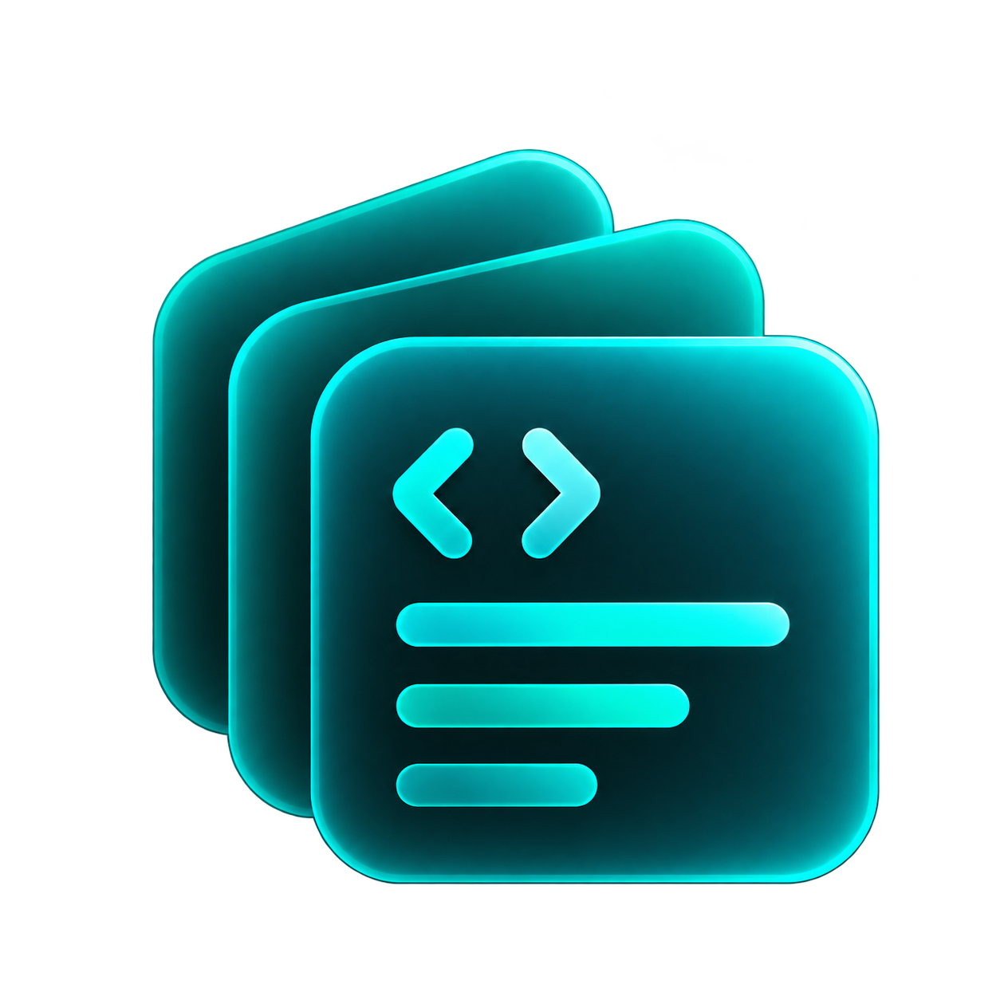

<div align="center">



# Snippets

**A quiet, fast place for the code and notes you keep coming back to.**

Capture a snippet in seconds, find it again just as quickly. Snippets runs entirely in your browser, so there's nothing to install, no account to create, and no server to set up.

[**Try the live demo →**](https://imranpollob.github.io/snippet-notes/)

[](https://nextjs.org/)
[](https://react.dev/)
[](https://developer.mozilla.org/en-US/docs/Web/API/Window/localStorage)
[](#license)

</div>

---

## Why Snippets?

Most of us keep useful snippets scattered across gists, chat history, and random text files. Snippets gives them one home that stays out of your way: open it, type or paste, and get back to work. When you need something later, search finds it before you've finished typing.

Your data lives in your browser by default. Nothing is sent anywhere unless you choose to turn on cloud sync.

## Features

- **One focused editor.** Create and edit in the same modal. New snippets get automatic language detection and a suggested title, and edits to existing snippets are saved as you type. Write, split, and preview modes are one click away for Markdown.
- **Instant search.** Press `/` and filter across titles, content, labels, and languages as you type.
- **Labels and pinning.** Organize snippets with labels, filter by them, and pin the ones you reach for most. Rename or delete labels across your whole library from one place.
- **Two ways to browse.** Switch between rich cards with syntax highlighting and a compact list for scanning many snippets at once.
- **Private by default.** Everything is stored in your browser's local storage. No tracking and no sign-in required.
- **Optional cloud sync.** Sign in with Google to sync snippets across devices using Firebase Firestore.
- **Your data stays portable.** Export and import a full JSON backup, or export a single snippet as a `.md` file.
- **Light and dark themes.** Follows your system preference, with no flash on page load.

## Keyboard shortcuts

Snippets is built to be driven from the keyboard. Press `?` anywhere in the app to see this list.

| Action                       | Shortcut               |
| :--------------------------- | :--------------------- |
| New snippet                  | `C`                    |
| Search                       | `/`                    |
| Create snippet / finish edit | `Esc`                  |
| Delete the open snippet      | `Shift + Backspace` ×2 |
| Cancel, close, or clear      | `Esc`                  |
| Show all shortcuts           | `?`                    |

Delete asks for confirmation: press `Shift + Backspace` once to arm it and a second time to confirm. It works even while your cursor is in the title or body.

## Getting started

You'll need [Node.js](https://nodejs.org/) 18.17 or later (required by Next.js 14).

```bash
git clone https://github.com/imranpollob/snippet-notes.git
cd snippet-notes
npm install
npm run dev
```

Then open [http://localhost:3000](http://localhost:3000).

### Building for production

```bash
npm run build
```

This produces a static site in `./out/` that you can host anywhere, such as GitHub Pages, Netlify, or any static file server. A GitHub Actions workflow for GitHub Pages is included in `.github/workflows/`.

## Optional: cloud sync with Firebase

Local mode works with no configuration. To enable Google sign-in and cross-device sync, create a Firebase project with Authentication (Google provider) and Firestore enabled, then add your project's keys to a `.env.local` file in the project root:

```bash
NEXT_PUBLIC_FIREBASE_API_KEY=your_api_key
NEXT_PUBLIC_FIREBASE_AUTH_DOMAIN=your_project.firebaseapp.com
NEXT_PUBLIC_FIREBASE_PROJECT_ID=your_project_id
NEXT_PUBLIC_FIREBASE_STORAGE_BUCKET=your_project.appspot.com
NEXT_PUBLIC_FIREBASE_MESSAGING_SENDER_ID=your_sender_id
NEXT_PUBLIC_FIREBASE_APP_ID=your_app_id
```

If any of these are missing, the app simply stays in local mode.

## Tech stack

- **Framework:** Next.js 14 (App Router, static export)
- **UI:** React 18
- **Styling:** plain CSS with variables and design tokens
- **Type:** Outfit, Plus Jakarta Sans, and JetBrains Mono
- **Optional backend:** Firebase Auth and Firestore

## Contributing

Bug reports, ideas, and pull requests are welcome. If you're planning something larger, please open an issue first so we can talk it through.

## License

Released under the MIT License.

## Author

Made by [Imran Pollob](https://github.com/imranpollob).
